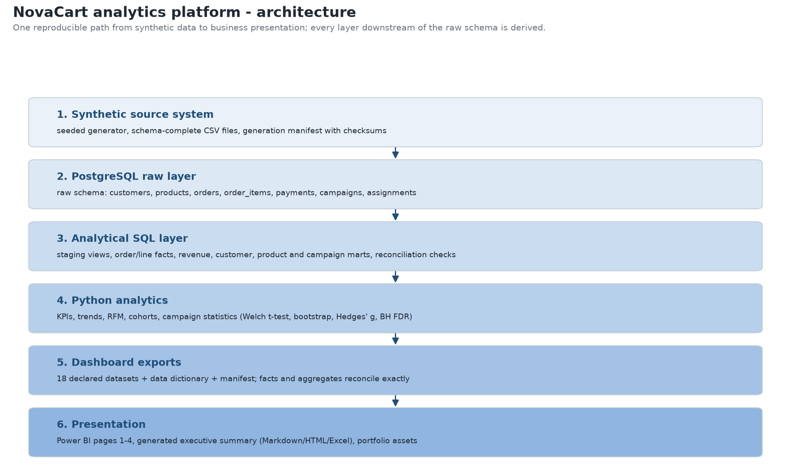
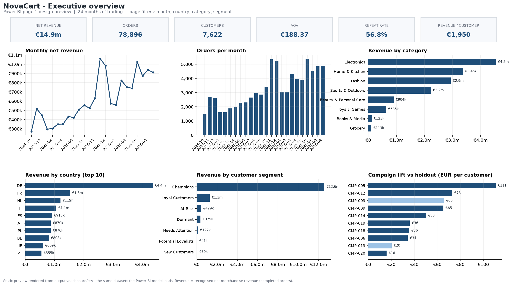

# E-commerce Customer & Revenue Analytics

## Overview

An end-to-end analytics system for a fictional e-commerce retailer, built as a portfolio project.
It starts from a seeded synthetic data generator, lands the data in PostgreSQL, models it into
staging views, facts and marts, and builds a tested Python analytics layer on top: revenue and
product analytics, customer analytics, RFM segmentation, cohort retention, and campaign evaluation
with statistical testing.

The outputs are packaged for business consumption: 18 dashboard-ready datasets with a declared
schema and data dictionary, a Power BI build kit, four static dashboard previews, a generated
executive summary, and a curated portfolio folder with an architecture diagram and a case study.

Everything is reproducible from a fresh clone with one command (`python scripts/run_pipeline.py`).
The same seed always produces the same dataset, every layer reconciles against the one above it,
and the pipeline stops at the first failed gate rather than continuing with questionable data.

The dataset is synthetic and the company is fictional - see [Portfolio Note](#portfolio-note).

## Business Problem

NovaCart is a fictional mid-sized European retailer selling across eight categories. Revenue is
growing, but the business cannot answer the questions that decide where the next euro should go:

1. How is revenue changing over time, and how seasonal is it?
2. Which products and categories drive revenue?
3. What is average order value and how does it move?
4. Which customers contribute the most revenue?
5. What is retention by acquisition cohort?
6. What customer segments exist based on RFM?
7. Which segments generate the most revenue and retain best?
8. Which marketing campaigns are associated with stronger customer value?
9. Are those campaign differences statistically meaningful?
10. What actions follow from the evidence?

NovaCart does not exist and is not based on a real company. The scenario exists so the analysis has
a realistic shape: 24 months of trading, repeat purchase behaviour, seasonality and randomised
marketing holdouts.

## What This Project Demonstrates

| Capability | How it is demonstrated |
| --- | --- |
| Python | Modular package (`src/novacart/`) covering generation, ingestion, analytics, statistics, exports and orchestration |
| SQL | Staging views, order/line facts, revenue, customer, product and campaign marts, plus reconciliation queries (`sql/`) |
| PostgreSQL | Schema with primary/foreign keys, check constraints, generated money columns and indexes; bulk `COPY` loading |
| ETL / data pipelines | Eleven-step fail-fast pipeline from generation to portfolio assets (`src/novacart/pipeline.py`) |
| Data quality and reconciliation | 59 in-memory checks, 15 raw SQL checks, 20 analytical checks, 12 end-to-end metrics |
| Business analytics | Revenue, order, AOV, units, trend, rolling-window and month-over-month analysis |
| RFM segmentation | Quintile scoring with deterministic tie-breaking and documented segment rules |
| Cohort analysis | Monthly cohorts by first purchase with an observability-aware retention matrix |
| Statistical testing | Welch t-test, confidence intervals, bootstrap, rank test, effect size, FDR control |
| Visualisation | 16 analytics figures plus four dashboard page renders, all generated from canonical data |
| Power BI preparation | Declared export schemas, data dictionary, DAX measures, theme and page specifications |
| Reproducibility and testing | Fixed seed, checksum manifests, 215 tests, reconciliation to zero difference |

## Architecture

```
synthetic data generator            src/novacart/synthetic/
        |  CSV files + generation manifest (checksums, ground truth)
        v
PostgreSQL raw layer                sql/01_schemas.sql, sql/02_raw_tables.sql
        |  7 source-shaped tables, keys, constraints, generated money columns
        v
SQL analytical layer                sql/10..90_*.sql
        |  staging views -> order/line facts -> revenue, customer, product, campaign marts
        v
Python analytics                    src/novacart/analytics/
        |  KPIs, trends, products, customers, RFM, cohorts, campaign statistics, charts
        v
Dashboard exports                   src/novacart/dashboard/
        |  18 datasets + data dictionary + manifest (facts and aggregates reconcile exactly)
        v
Power BI, executive summary, portfolio assets
```

Two cross-cutting pieces hold the layers together:

* **Orchestration** - `src/novacart/pipeline.py` runs the whole workflow and aborts on the first
  failed validation, naming the step and the cause.
* **Reconciliation** - `src/novacart/reconciliation.py` compares raw, analytical and exported totals
  metric by metric, with a documented zero-difference expectation.



Implementation detail: [docs/architecture.md](docs/architecture.md)

## Data Model

Seven raw tables, one payment per order:

| Table | Grain | Rows |
| --- | --- | ---: |
| `raw.customers` | customer | 15,000 |
| `raw.products` | product | 1,200 |
| `raw.marketing_campaigns` | campaign | 20 |
| `raw.campaign_assignments` | campaign x customer | 44,090 |
| `raw.orders` | order | 84,263 |
| `raw.order_items` | order line | 207,374 |
| `raw.payments` | order (one per order) | 84,263 |

The analytical schema adds staging views (`stg_*`), published facts (`fct_orders`,
`fct_order_lines`), marts (`mart_revenue_daily/monthly`, `mart_customer_features`,
`mart_product_performance`, `mart_category_performance`, `mart_campaign_customer_outcomes`,
`mart_campaign_performance`) and `analytics.reconciliation_checks`.

**Why `campaign_assignments` exists.** The business question "are campaign differences
statistically meaningful?" cannot be answered from orders alone, because there is nothing to
compare against. The table records, per campaign, which customers were randomised into the
treatment arm and which into the holdout arm, whether a treatment customer was actually exposed,
and when the assignment happened. It is the experimental design that makes the campaign analysis
possible, and it is separate from order attribution (which only appears on orders from exposed
treatment customers inside the campaign window).

Column-level reference: [docs/data_model.md](docs/data_model.md)

## Dataset

| Property | Value |
| --- | --- |
| Nature | Synthetic, generated by this repository - not a real company's data |
| Analysis window | 2024-10-01 to 2026-09-30 (730 days, 24 complete months) |
| Seed | `20261004` |
| Scale | 15,000 customers, 1,200 products, 20 campaigns, 44,090 assignments, 84,263 orders, 207,374 order lines, 84,263 payments |
| Determinism | Same seed and configuration produce byte-identical CSV files |

The generator models acquisition channels with differing retention bias, category price and margin
structure, product-level trends, yearly and weekly seasonality with Black Friday peaks, a
casual/loyal purchase mix, and randomised campaign holdouts with documented true lift for later
validation. Assumptions and calibration: [docs/data_generation.md](docs/data_generation.md).

## Analytical Workflow

`python scripts/run_pipeline.py` performs the workflow below in order and stops at the first
failure. `--list` prints the steps; `--with-tests` adds the test suite as a final step.

| # | Stage | What happens | Gate |
| ---: | --- | --- | --- |
| 1 | Generation | Seeded generation of customers, catalogue, campaigns, orders and payments to CSV | 59 in-memory integrity checks; refuses to write invalid data |
| 2 | Validation | Generated files are compared with the generation manifest | CSV SHA-256 checksums must match |
| 3 | Raw ingestion | Schemas applied, CSVs bulk-loaded with `COPY` | Row counts recorded in `meta.ingestion_run` |
| 4 | Raw checks | 15 SQL cross-table checks | Any failing check aborts the run |
| 5 | Analytical SQL layer | Staging views, facts and marts rebuilt in dependency order | 18 views recreated |
| 6 | Analytical reconciliation | Raw totals compared with analytical totals | 20 checks, all must pass |
| 7 | Python analytics | KPIs, trends, products, customers | 25 tables and 16 figures written |
| 8 | RFM and cohort analysis | Segment scoring and monthly cohort retention | RFM deterministic; cohort invariants validated |
| 9 | Campaign and statistical analysis | Customer-level treatment/holdout comparison with tests | Results table with confidence intervals and FDR-adjusted p-values |
| 10 | Dashboard exports | 18 datasets, data dictionary, manifest, executive summary | Export schemas validated; facts reconcile with aggregates |
| 11 | End-to-end reconciliation | Raw, analytical and exported totals compared | 12 metrics, zero difference expected |
| 12 | Portfolio assets | Architecture diagram, screenshots, sample outputs | Manifest with checksums |

## Revenue Definition

This project uses exactly **two** revenue figures, and no third definition:

* **Recognised revenue (the business definition)** is *net merchandise revenue from completed
  orders*: `items_subtotal - discount_amount` for orders with status `completed`. Refunded and
  cancelled orders are excluded, and **shipping and VAT are never part of revenue**. Every KPI,
  chart, cohort, RFM score, campaign test and dashboard visual uses this figure.
* **Canonical net revenue (the raw field)** is `raw.orders.net_revenue`, the database-generated
  amount stored for **every** order regardless of status. It exists so no layer has to recompute
  the order amount, and so refunded and cancelled value stays visible in the data.

The two figures differ only by the refunded and cancelled merchandise value:

| Measure | Value |
| --- | ---: |
| Recognised revenue (completed orders only) | EUR 14,861,510.32 |
| Canonical net revenue across all order statuses | EUR 15,873,819.08 |
| Refunded + cancelled merchandise value | EUR 1,012,308.76 |

Shipping and VAT are stored separately on the order and are excluded from both figures. Wherever a
number in this repository is described simply as "revenue", it is recognised revenue.

## Business KPIs

Verified figures for the full analysis window (generated by
`outputs/dashboard/csv/kpi_summary.csv`):

| KPI | Value |
| --- | ---: |
| Recognised revenue | EUR 14,861,510.32 |
| Recognised orders | 78,896 |
| Recognised units | 250,532 |
| Purchasing customers | 7,622 |
| Registered customers | 15,000 |
| Average order value | EUR 188.37 |
| Average units per order | 3.18 |
| Revenue per purchasing customer | EUR 1,949.82 |
| Revenue per registered customer | EUR 990.77 |
| Repeat customers / one-time customers | 4,331 / 3,291 |
| Repeat customer rate | 56.82% |

## Customer Analytics

Customer analytics run on `analytics.mart_customer_features`, which keeps **all 15,000 registered
customers**, including the 7,378 who never purchased. Purchasing customers are the 7,622 with at
least one recognised order; a repeat customer has two or more.

Customer value is heavily concentrated: the top 1% of purchasing customers hold 9.18% of revenue,
the **top 10% hold 53.05%**, and the bottom half hold 4.03%. This is why revenue metrics are always
reported alongside customer counts rather than as averages alone.

### RFM segmentation

Recency (days since last purchase, measured against the fixed analysis end date), frequency
(recognised orders) and monetary value (recognised revenue) are each split into quintiles over
purchasing customers. Ties are broken deterministically by customer id, so the same data always
produces the same scores. Segments are assigned by documented priority rules: Champions, Loyal
Customers, Potential Loyalists, New Customers, At Risk, Needs Attention, Dormant, plus a Never
Purchased group kept with null scores rather than dropped.

| Segment | Customers | Share of customers | Revenue | Share of revenue |
| --- | ---: | ---: | ---: | ---: |
| Champions | 2,201 | 14.67% | EUR 12,582,779.05 | 84.67% |
| Loyal Customers | 1,317 | 8.78% | EUR 1,273,054.47 | 8.57% |
| At Risk | 1,055 | 7.03% | EUR 429,187.33 | 2.89% |
| Dormant | 1,994 | 13.29% | EUR 374,729.94 | 2.52% |
| Needs Attention | 647 | 4.31% | EUR 121,722.45 | 0.82% |
| Potential Loyalists | 201 | 1.34% | EUR 40,680.44 | 0.27% |
| New Customers | 207 | 1.38% | EUR 39,356.64 | 0.26% |
| Never Purchased | 7,378 | 49.19% | EUR 0.00 | 0.00% |

Method and rule detail: [docs/analytics_methods.md](docs/analytics_methods.md#2-rfm-methodology)

## Cohort Analysis

Customers are grouped into monthly cohorts by the month of their **first recognised order**.
Retention is measured as having at least one recognised order in a month offset counted from that
cohort month, so **month 0 is 100% of the cohort by construction** and no retention value can
exceed 100%. Month offsets beyond the analysis end date are left blank rather than counted as zero
retention, so later cohorts show fewer columns.

The default run produces 24 monthly cohorts. Median month-1 activity retention is **21.3%** across
the 23 observable cohorts (21.2% if the left-censored first cohort is excluded).

Three limitations belong with the numbers:

* The **first cohort (2024-10) is left-censored**: customers who were already active before the
  loaded window have their first *observed* order in that month, so it mixes new and pre-existing
  customers and shows 73.2% month-1 retention against roughly 21% elsewhere. It should be excluded
  from retention benchmarks.
* The generated customer behaviour has **no churn-decay process**, so retention is flatter than a
  real retail cohort would be.
* Retention is order-based, not subscription-based: one order in a month counts as retained.

## Product Analytics

Category and product performance use recognised revenue and units from the order lines.

| Category | Revenue | Share of revenue |
| --- | ---: | ---: |
| Electronics | EUR 4,544,230.20 | 30.58% |
| Home & Kitchen | EUR 3,375,618.05 | 22.71% |
| Fashion | EUR 2,936,855.20 | 19.76% |

Products are ranked on recognised revenue, with ties broken by product id; a separate ranking by
recognised units is always published alongside, because the two lists differ. The largest single
product is **Marlow Smart Watch Pro** with EUR 228,769.45 of recognised revenue.

**Declining products** use an explicit, documented rule: compare the most recent 90 days of the
analysis window with the 90 days immediately before it, and flag a product when it sold at least
10 units in the prior window **and** its recognised units fell by 30% or more. The comparison
window ends on the last order date in the data, never on the wall clock, so the result is
reproducible. In the default run **162 of 1,118 comparable products** met the rule.

`product_performance` contains the **1,195 products with at least one recognised sale**; five
catalogue products had no sales in the window and contribute zero revenue rather than appearing as
zero rows. This is recorded in the generated data dictionary.

## Campaign Analysis

The dataset contains a randomised experiment, not an observational comparison:

* each campaign assigned its audience into a **treatment arm (72%)** and a **holdout arm (28%)**;
* audiences ranged from 601 to 6,296 customers (44,090 assignments across 20 campaigns);
* campaign windows ran for 22 to 49 days;
* within the treatment arm, about 93% of customers were exposed (92.9% overall in this run);
* **order attribution is only recorded for exposed treatment customers, only for orders inside the
  campaign window**, and never for the holdout arm.

The **unit of analysis is the customer**, not the order: orders from one customer are not
independent observations, and treating them as such would understate uncertainty. The primary
comparison is **intention-to-treat** - everyone randomised to treatment versus everyone randomised
to holdout, whether or not they were exposed - because that preserves the randomisation. Outcome
metrics are recognised revenue per assigned customer inside the campaign window, and customer
counts, revenue and average customer revenue are reported for both arms before any test is run.

| Result | Count |
| --- | ---: |
| Campaigns evaluated | 20 |
| Statistically significant at FDR 5% | 8 |
| Clearing the practical thresholds | 11 |
| Both statistical and practical | 8 |
| Directionally positive but inconclusive | 3 |
| No detectable difference | 9 |

The largest measured effect is **CMP-005**, with EUR 110.86 more recognised revenue per assigned
customer than its holdout (**+51.66%**, 95% confidence interval EUR 75.16 to EUR 146.55).

Findings describe this randomised synthetic experiment. They are not presented as universally
causal results, and real-world campaign data is usually observational. The generator's ground truth
is never used to produce or select any analytical result; it only exists for the clearly marked
post-hoc validation in `notebooks/04_campaign_analysis.ipynb`.

## Statistical Methodology

| Element | Implementation |
| --- | --- |
| Primary test | Welch's two-sample t-test on per-customer revenue, which does not assume equal variances between the unequal treatment and holdout groups |
| Interval | 95% confidence interval for the difference in means using Welch-Satterthwaite degrees of freedom |
| Robustness checks | Percentile bootstrap confidence interval (deterministic seed, 1,000 iterations) and a Mann-Whitney U test, because customer revenue is heavy-tailed |
| Effect size | Hedges' g (bias-corrected Cohen's d), with conventional magnitude labels |
| Multiplicity | Benjamini-Hochberg false-discovery-rate control at q = 0.05 across the 20 campaigns |
| Statistical significance | FDR-adjusted p-value < 0.05 |
| Practical significance | Pre-specified rule: at least 10% relative lift **and** at least EUR 5.00 absolute lift per assigned customer |

Multiple methods are used deliberately: the t-test answers "is the mean difference distinguishable
from zero", the interval shows how precise that estimate is, the bootstrap and rank test check that
the conclusion is not an artefact of a few large customers, and the effect size puts the magnitude
on a standardised scale. Statistical and practical significance are reported separately because a
precisely estimated but tiny difference is not a reason to act.

All of these choices are fixed in code (`src/novacart/analytics/statistics.py`,
`analytics/campaigns.py`) before results are inspected. Full rationale, including the alternatives
considered: [docs/analytics_methods.md](docs/analytics_methods.md#5-statistical-test-selection)

## Dashboard

This repository contains a **Power BI build kit**, not a `.pbix` file:

| Asset | Location |
| --- | --- |
| Dashboard-ready data exports (18 datasets) | `outputs/dashboard/csv/` |
| Data dictionary (230 documented columns) | `outputs/dashboard/csv/data_dictionary.csv` |
| Export manifest (row counts, checksums) | `outputs/dashboard/csv/export_manifest.json` |
| DAX measures | `powerbi/measures.dax` |
| Theme (colours, typography, card styling) | `powerbi/theme.json` |
| Page specifications and data model relationships | `powerbi/page_specs.md`, `powerbi/README.md` |
| Four static page previews | `powerbi/screenshots/`, `portfolio/screenshots/` |

| Page | Content |
| --- | --- |
| 1. Executive overview | revenue, orders, customers, AOV, repeat rate and revenue per customer; monthly revenue and order trends; revenue by category, segment and country; campaign lift |
| 2. Customer analytics | RFM segment distribution and revenue, customer value deciles, cohort retention heatmap, cohort sizes |
| 3. Product analytics | category revenue and units, top products, declining products, category detail |
| 4. Campaign analytics | treatment versus holdout comparison, lift and confidence intervals, significance indicators, full results table |



The images above and in `portfolio/screenshots/` are **static renders of the dashboard design**,
produced from the same exported datasets the Power BI model loads - they are not Power BI
screenshots.

**Manual step.** Assembling the `.pbix` in Power BI Desktop is manual, because headless Power BI
automation was not available in the development environment. No `.pbix` file is included. The build
guide (`powerbi/README.md`) covers connecting the CSV folder, the date table, the model
relationships, the measures and the theme; `powerbi/page_specs.md` lists every visual field by
field.

## Key Findings

* **Recognised revenue for the 24-month window is EUR 14,861,510.32** across 78,896 completed
  orders, with an average order value of EUR 188.37.
* **Revenue is seasonal and growing**: the November 2025 peak reached EUR 1,061,209.94 in a single
  month, and revenue in the last 12 months (EUR 9,878,510.51) was 98.2% higher than the previous 12
  (EUR 4,982,999.81).
* **Revenue is highly concentrated in customers**: the top 10% of purchasing customers hold 53.05%
  of revenue, and the 2,201 Champions (14.67% of customers) generate EUR 12,582,779.05 (84.67%).
* **1,055 At Risk customers represent EUR 429,187.33 of historical revenue** - customers who used to
  buy and have stopped, which makes them the clearest reactivation target.
* **Category revenue is led by Electronics** at EUR 4,544,230.20 (30.58% of revenue), followed by
  Home & Kitchen (22.71%) and Fashion (19.76%).
* **Cohort retention is around 21% per month** (median month-1 retention 21.3% across 23 observable
  cohorts), with the documented left-censoring and no-churn-decay caveats.
* **Campaign evidence is mixed, not uniformly positive**: 8 of 20 campaigns are statistically
  significant at a 5% false-discovery rate and also clear the practical thresholds, 3 are
  directionally positive but inconclusive, and 9 show no detectable difference.
* **162 of 1,118 comparable products met the documented decline rule** (prior units >= 10 and a unit
  change of -30% or worse).

Recommended actions derived from these results are generated in
`outputs/dashboard/summary/executive_summary.md` (a copy is committed at
[portfolio/sample_outputs/executive_summary.md](portfolio/sample_outputs/executive_summary.md)).

## Data Quality & Validation

| Gate | Scope | Result |
| --- | ---: | --- |
| Generator (in memory) | 59 checks | Pass; invalid data is never written |
| Raw layer (SQL) | 15 checks | 0 failing |
| Analytical layer (SQL) | 20 checks | 0 failing |
| Dashboard exports | Declared schemas, row counts, fact-versus-aggregate reconciliation | 0 differences |
| End-to-end (raw -> analytical -> exported) | 12 metrics | 0.00 money difference, 0 count difference |

The generator verifies keys, foreign keys, date logic, money arithmetic and totals before writing
anything. The raw checks cover orphan keys, one payment per order, order subtotal and discount
reconciliation, no orders before signup, no sales before product launch, control-arm exposure,
attribution inside campaign windows and payment status consistency. The analytical checks reconcile
raw totals with the modelled layer, and the export tests prove that the sliceable fact tables
reproduce every aggregate exactly.

The final three-layer reconciliation compares revenue (canonical and recognised), orders, units,
customers, customer revenue totals, product revenue totals, campaign attributions and assignments,
with a 0.01 EUR tolerance for money and exact matching for counts. Detail:
[docs/testing.md](docs/testing.md)

## Testing

Final verified status:

| Check | Command | Result |
| --- | --- | --- |
| Test suite with database integration | `NOVACART_RUN_DB_TESTS=1 python -m pytest` | **215 passed** (179 unit + 36 database-backed) |
| Unit suite only | `python -m pytest` | 179 passed, 36 skipped |
| Full-scale generation test | `python -m pytest -m slow` | 1 passed |
| Compile check | `python -m compileall -q src scripts tests` | Passes |
| Lint | `python -m ruff check src tests scripts` | Passes |
| Notebook execution | `python -m nbconvert --to notebook --execute --inplace notebooks/0*.ipynb` | All four notebooks execute with no errors |
| End-to-end pipeline | `python scripts/run_pipeline.py` | 11 steps, all gates passed (~57 seconds) |

The suite covers generator determinism and integrity, schema constraints, SQL reconciliation,
metric mathematics on hand-built frames, RFM rules (including all 125 score combinations), cohort
invariants, statistical correctness against hand-computed values, dashboard export schemas and
fact-versus-aggregate reconciliation, executive-summary content, portfolio assets, and pipeline
fail-fast behaviour.

## Project Structure

```
docker-compose.yml        PostgreSQL 16 for local development
pyproject.toml            dependencies, console scripts, pytest and ruff configuration
.env.example              documented local configuration (no secrets committed)

sql/                      01_schemas, 02_raw_tables, 10 staging views, 20-23 marts,
                          90 reconciliation checks, checks/verify_raw.sql
src/novacart/
  synthetic/              deterministic generator (reference data, entities, order simulation)
  ingestion/              schema application, COPY loading, raw data-quality checks
  warehouse.py            builds the analytical SQL layer and reads reconciliation results
  analytics/              revenue, KPIs, trends, products, customers, RFM, cohorts,
                          campaigns, statistics, plots, report
  dashboard/              declared export schemas, datasets, executive summary, page previews
  reconciliation.py       end-to-end raw -> analytical -> exported reconciliation
  portfolio.py            architecture diagram, portfolio images, sample outputs
  pipeline.py             eleven-step fail-fast orchestration
scripts/                  thin CLI wrappers for every stage
notebooks/                01 business analysis, 02 customer segmentation,
                          03 cohort analysis, 04 campaign analysis
powerbi/                  measures.dax, theme.json, page_specs.md, README.md, screenshots
portfolio/                screenshots, sample outputs, case study
docs/                     architecture, data model, data generation, methods, testing
data/, outputs/           generated artefacts, intentionally git-ignored and rebuildable
tests/                    unit, database integration and rule-injection tests
```

## Setup

Prerequisites: Python 3.12+ (developed and verified on 3.14), Docker with `docker compose`, and
optionally Power BI Desktop for the dashboard.

```bash
git clone <repository-url>
cd ecommerce-customer-revenue-analytics

cp .env.example .env                  # Windows PowerShell: Copy-Item .env.example .env
docker compose up -d                  # PostgreSQL 16 on localhost:5433

python -m venv .venv
. .venv/Scripts/activate              # macOS/Linux: source .venv/bin/activate
python -m pip install -e ".[dev]"
```

The local `.env` contains throwaway development credentials only; `.env` is git-ignored and no
credentials are committed.

## Reproduction

The shortest reliable path from a fresh clone:

```bash
git clone <repository-url>
cd ecommerce-customer-revenue-analytics
cp .env.example .env
python -m venv .venv
. .venv/Scripts/activate
python -m pip install -e ".[dev]"
docker compose up -d
python scripts/run_pipeline.py
```

`python scripts/run_pipeline.py` generates the data, loads it, builds the warehouse and analytics,
runs every validation gate, exports the dashboard datasets and executive summary, reconciles the
three layers and rebuilds the portfolio assets. It stops at the first failure and prints the failing
step, the reason and the steps completed. Add `--with-tests` to finish with the test suite, or
`--list` to see the steps.

Individual stages are also available, either as scripts or as console entry points:

```bash
python scripts/generate_data.py           # novacart-generate
python scripts/load_raw.py                # novacart-load
python scripts/check_raw_data.py
python scripts/build_analytics_layer.py   # novacart-build-analytics
python scripts/run_reconciliation.py      # novacart-reconcile
python scripts/build_business_analysis.py # novacart-analyze
python scripts/build_dashboard.py         # novacart-dashboard
python scripts/build_portfolio.py         # novacart-portfolio
```

Generated artefacts are deliberately **not committed**: `data/` (CSVs and the generation manifest)
and `outputs/` (tables, figures, dashboard exports, executive summary) are git-ignored and rebuilt
by the pipeline. The curated outputs that are committed live in `portfolio/`, including the
architecture diagram, dashboard previews, sample result files and a copy of the end-to-end
reconciliation report. Reproducibility rests on the fixed seed (`20261004`), the generation
manifest's checksums and the export manifest's checksums.

## Limitations

* **Synthetic data.** All customers, orders and campaigns are generated. The project demonstrates
  analytical and data-engineering method, not a real commercial outcome, and reports no real
  business impact.
* **Randomised campaign design differs from real-world observational data.** Real client data often
  contains confounding, selection bias, targeting effects and non-random exposure, so these effect
  estimates are not automatically transferable.
* **Intention-to-treat dilution.** The primary campaign estimate includes treatment-arm customers
  who were never exposed (7% of the arm), so it understates the effect on the exposed population.
* **Cohort left-censoring.** The 2024-10 cohort contains customers who were already active before
  the loaded window and shows 73.2% month-1 retention against roughly 21% elsewhere; it should be
  excluded from retention benchmarks.
* **No churn-decay process.** The generator gives customers a constant order intensity, so cohort
  retention is flatter than a real retail cohort. The cohort method is correct; the data design is
  the simplification.
* **Heavy-tailed customer revenue.** The top decile holds 53.05% of revenue, so mean-based
  statistics are complemented by bootstrap and rank-based checks - mitigated, not eliminated.
* **Small standardised effects.** The significant campaigns show Hedges' g between 0.111 and 0.236;
  large percentage lifts on small bases still produce modest effect sizes.
* **`.pbix` assembly is manual.** Headless Power BI automation was unavailable, so the dashboard is
  delivered as datasets, measures, theme and page specifications plus static previews.
* **Five products have no sales.** `product_performance` covers the 1,195 products with at least
  one recognised sale; the other five appear nowhere in product rankings by design.

## Portfolio Note

* **NovaCart is a fictional company.** It does not exist and is not based on any real retailer.
* **All data is synthetic**, generated by the seeded generator in this repository. No real
  customer, order or payment data is used anywhere.
* This is a **personal portfolio project**. It is **not presented as client work**, consulting
  engagement, or a deployed production system - it demonstrates production-style engineering
  practices.
* **No real business impact is claimed.** The synthetic findings are not evidence about any real
  market, product or campaign.
* **All reported results are produced by the reproducible implementation** in this repository;
  nothing is hand-written or hard-coded into the analytical outputs.

Case study: [portfolio/case-study.md](portfolio/case-study.md) - code is provided for portfolio and
educational use, and any resemblance to real customers, orders or companies is coincidental.

